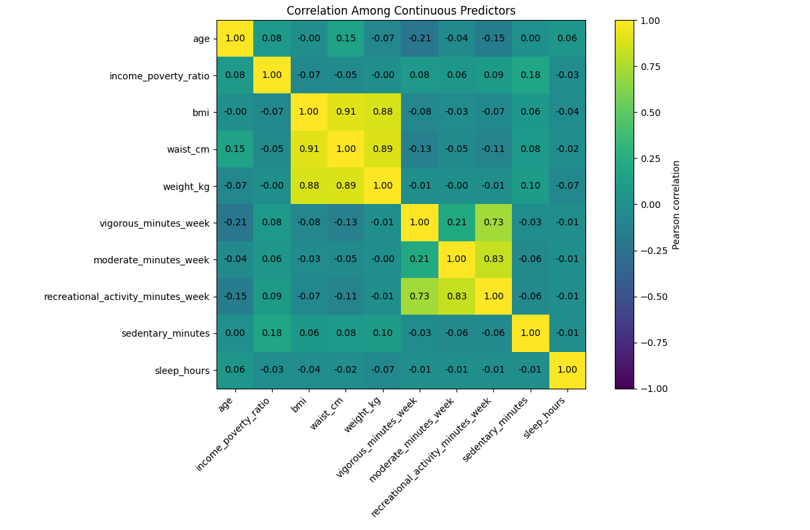

# Identifying Hidden Glycemic Risk using Machine Learning: An Analysis of U.S. Adults without diagnosed diabetes. 

- **Prepared for:** UMBC Data Science Master Degree Capstone, Dr. Chaojie (Jay) Wang 
- **Author**: Shristi Pokharel
- **GitHub Repository:** [UMBC DATA606 Capstone](https://github.com/winglessdeman/UMBC-DATA606-Capstone)
- **PowerPoint Presentation:** [Final Capstone Presentation](https://docs.google.com/presentation/d/1RcuCA3hMLdgMUhZl3_jZcrc8IVwGSDwQ/edit)
- **Streamlit Application:** [NHANES HbA1c Screening](https://nhanes-hba1c-screening.streamlit.app/)
- **EDA Notebook:** [nhanes_eda.ipynb](../notebooks/nhanes_eda.ipynb)
- **Modeling Notebook:** [nhanes_modeling.ipynb](../notebooks/nhanes_modeling.ipynb)
- **YouTube Presentation:** 
- **LinkedIn:** 

## 1. Project Overview

This project investigates whether non-laboratory demographic, socioeconomic,
anthropometric, behavioral, and health-history characteristics can help identify
elevated HbA1c among U.S. adults who do not report a previous diabetes diagnosis.

NHANES data from 2011–2018 are used to develop and evaluate machine-learning
models for elevated HbA1c risk. The project is intended as a research and
educational risk-screening demonstration and not as a diagnostic tool or
replacement for laboratory HbA1c testing.

# 2. Background

Diabetes and prediabetes are usually evaluated using HbA1c : a laboratory measurement that reflects average blood glucose over time. 
Some individuals might have elevated HbA1c even though they have not been officially diagnosed with diabetes.
This project uses data from the  (NHANES) National Health and Nutrition Examination Survey that is conducted by the (CDC)
National Center for Health Statistics within the Centers for Disease Control and Prevention. 
NHANES combines interviews, physical examinations and laboratory testing thus providing demographic, socioeconomic, 
anthropometric, behavioral, cardiovascular, and laboratory information for the U.S participants.

This project focuses on adults without a previously reported diabetes diagnosis. 
Laboratory-measured HbA1c will be used as the outcome source, the machine learning predictors 
will be limited primarily to variables that are available without performing HbA1c laboratory test. 
This project will investigate whether non-laboratory characteristics can be used to distinguish 
participants with normal HbA1c from the participants that have elevated HbA1c. 

HbA1c testing can identify elevated glycemic levels, but it requires a laboratory test.
In this project I explore whether the commonly available non-laboratory information such as age, BMI, waist circumference, physical activity, smoking behavior, sleep duration, income, education, hypertension, and high cholesterol can help to identify patterns associated with elevated HbA1c. If these characteristics can successfully distinguish individuals with elevated HbA1c, then the machine-learning model could demonstrate how routinely available health and lifestyle information may be used to support screening decisions and identify individuals who may benefit from further laboratory testing . Although the model cannot be used to diagnose diabetes or replace HbA1c testing it can be a risk-screening and educational tool for individuals wanting to make changes in their lifestyle and seek medical attention.   

I set 4 research questions for this project:

#### RQ1
Can non-laboratory demographic, Biometric, behavioral, cardiovascular, and socioeconomic characteristics be used to identify elevated HbA1c among adults without a previously reported diabetes diagnosis?

#### RQ2
Which non-laboratory characteristics are most important for identifying elevated HbA1c?

#### RQ3
Do behavioral and socioeconomic characteristics improve the prediction of elevated HbA1c beyond basic factors such as age and BMI?

#### RQ4
Can elevated HbA1c be identified among adults who are not obese?

The Streamlit application will be a simple glycemic-risk screening demonstration where an user would enter non-laboratory information similar to the variables used in the model, and the app would return the model's estimated likelihood/classification of elevated HbA1c.

# 3. Data

### Data Source: 
The project uses publicly available data from the CDC/NCHS National Health and Nutrition Examination Survey (NHANES). The data and documentation are available from the following links:

- NHANES website: https://www.cdc.gov/nchs/nhanes/
- NHANES data search and documentation: https://wwwn.cdc.gov/nchs/nhanes/

### Data size:
The project uses 32 SAS Transport (`.xpt`) files: eight NHANES components
from each of four survey cycles. The combined raw file size is approximately 65.20 MB.

### Data shape:
- After combining the four NHANES cycles and merging the eight components using
`SEQN`, the working merged dataset contains:

- **39,156 rows**
- **30 columns**
- **39,156 unique participants**
- **0 duplicate participant identifiers**

### Final Analysis Dataset

After study-population filtering and feature engineering, the final
analysis-ready dataset contains:

- **17,156 participants**
- **32 variables**
- **17,156 unique participant identifiers**
- **0 duplicate participant identifiers**

For the primary analysis, the study population is restricted to participants who:

- are age 20 years or older;
- have a valid laboratory HbA1c measurement; and
- reported no previous diabetes diagnosis (DIQ010 = 2).

Following exploratory data analysis (EDA), feature selection, and redundancy assessment, 13 non-laboratory predictors were selected for the final machine-learning model. The remaining variables were not all used as model inputs. Some were retained for identifying participants, constructing the target variable, feature engineering, or documenting the NHANES survey design.

### Time Period:
It includes four continuous pre-pandemic NHANES survey cycles. 

- 2011–2012
- 2013–2014
- 2015–2016
- 2017–2018

### What does each row represent?
- Each row represents the unique participant identifiers from the survey cycle.
- **SEQN**  is used as the unique participant identifier and merge key across the eight data components.

### Data Dictionary

| Column | Type | Definition | Potential Values / Units | Role |
|---|---|---|---|---|
| `age` | Numeric | Participant age | Years; 20–80 | Predictor |
| `sex` | Categorical | Participant sex | NHANES coded categories | Predictor |
| `race_ethnicity` | Categorical | Participant race/ethnicity | NHANES coded categories | Predictor |
| `education` | Categorical | Adult educational attainment | NHANES education categories | Predictor |
| `income_poverty_ratio` | Numeric | Family income-to-poverty ratio | 0–5 | Predictor |
| `bmi` | Numeric | Body Mass Index | kg/m² | Predictor |
| `waist_cm` | Numeric | Waist circumference | Centimeters (cm) | Predictor |
| `recreational_activity_minutes_week` | Numeric | Derived total vigorous and moderate recreational activity | Minutes/week | Predictor |
| `sedentary_minutes` | Numeric | Time spent sitting or reclining on a typical day | Minutes/day | Predictor |
| `smoking_status` | Categorical | Derived overall smoking status using lifetime and current smoking responses | Never, Former, Current | Predictor |
| `sleep_hours` | Numeric | Usual weekday/workday sleep duration | Hours | Predictor |
| `hypertension` | Categorical | Whether participant reports being told they have hypertension/high blood pressure | Yes / No | Predictor |
| `high_cholesterol` | Categorical | Whether participant reports being told they have high cholesterol | Yes / No | Predictor |

### NHANES Data Components and Selected Predictors

Eight NHANES data components were used to construct the analysis dataset. Six components contributed the 13 non-laboratory predictor variables, while two were used to define the prediction target and study population.

| Component | Description | Selected Predictors | Count |
|---|---|---|---:|
| `DEMO` | Demographics | `age`, `sex`, `race_ethnicity`, `education`, `income_poverty_ratio` | 5 |
| `GHB` | Glycohemoglobin | None — laboratory HbA1c used to define the target | 0 |
| `BMX` | Body Measures | `bmi`, `waist_cm` | 2 |
| `DIQ` | Diabetes Questionnaire | None — used for study eligibility | 0 |
| `PAQ` | Physical Activity | `recreational_activity_minutes_week`, `sedentary_minutes` | 2 |
| `SMQ` | Smoking | `smoking_status` | 1 |
| `SLQ` | Sleep Disorders | `sleep_hours` | 1 |
| `BPQ` | Blood Pressure & Cholesterol | `hypertension`, `high_cholesterol` | 2 |
| **Total** | **8 components** | **13 non-laboratory predictors** | **13** |

Some predictors, including recreational activity minutes per week and smoking status, were derived through feature engineering from multiple questionnaire responses.

#### Target Variable

The model predicts whether a participant has elevated HbA1c based on non-laboratory information.

| Column | Type | Definition | Potential Values / Units | Role |
|---|---|---|---|---|
| `hba1c` | Numeric | Laboratory-measured glycated hemoglobin | Percentage (%) | Target source |
| `elevated_hba1c` | Binary | Classification derived from laboratory HbA1c | 0 = HbA1c below 5.7%; 1 = HbA1c at or above 5.7% | Prediction target |

The laboratory-measured `hba1c` variable was used only to construct the classification target and was excluded from the model predictors to prevent data leakage.

# 4. Exploratory Data Analysis

Exploratory data analysis (EDA) was performed to understand the structure and quality of the analysis dataset, examine the distribution of HbA1c and candidate predictors, identify missing values and potential outliers, evaluate relationships between predictors and elevated HbA1c, and guide feature selection for machine-learning modeling.

### Data Cleaning and Preparation

NHANES data from the 2011–2012, 2013–2014, 2015–2016, and 2017–2018 survey cycles were combined for analysis.

Smoking questionnaire responses were combined into a `smoking_status` variable with three categories:

- Never
- Former
- Current

---

### HbA1c Distribution

*Figure 1. Distribution of HbA1c levels among NHANES participants (2011–2018). The dashed lines indicate the prediabetes threshold (5.7%) and diabetes threshold (6.5%).*

Before converting HbA1c into a binary target, the original laboratory HbA1c measurements were examined to understand where participants fell within the overall distribution.

| Statistic | HbA1c (%) |
|---|---:|
| Count | 17,156 |
| Minimum | 3.60 |
| 25th percentile | 5.20 |
| Mean | 5.52 |
| Median | 5.50 |
| 75th percentile | 5.70 |
| Maximum | 14.30 |
| Standard deviation | 0.60 |

HbA1c values ranged from **3.6% to 14.3%**, with a mean of **5.52%** and a median of **5.50%**.

The middle 50% of participants had HbA1c values between **5.2% and 5.7%**. The 75th percentile was 5.7%, which corresponds to the threshold used to define the elevated HbA1c target.

Although most participants were concentrated near the normal range, the maximum HbA1c value of 14.3% shows that some adults who did not report a previous diabetes diagnosis had substantially elevated laboratory measurements.

### Target Distribution

| HbA1c Group | Participants | Percent |
|---|---:|---:|
| Normal HbA1c | 11,693 | 68.16% |
| Elevated HbA1c | 5,463 | 31.84% |

Approximately **31.8% of the analysis population had elevated HbA1c**.

Because the outcome is moderately imbalanced, machine-learning performance will be evaluated using recall, precision, F1-score, ROC-AUC, and Precision-Recall AUC in addition to accuracy.

---

### Missing Data Assessment

Missingness was examined before modeling.

Some raw NHANES questionnaire variables contained high levels of missing data because of questionnaire skip patterns. For example, participants who reported no vigorous or moderate recreational activity were not asked follow-up questions about the number of activity days or minutes.

Derived variables substantially reduced this issue. Total weekly recreational activity and the combined smoking-status variable were therefore preferred over several raw questionnaire variables.

Missingness among the final candidate predictors was:

| Predictor | Missing Count | Missing Percent |
|---|---:|---:|
| Income-to-poverty ratio | 1,629 | 9.50% |
| Waist circumference | 816 | 4.76% |
| BMI | 193 | 1.12% |
| Sedentary minutes | 109 | 0.64% |
| High cholesterol | 78 | 0.45% |
| Sleep hours | 60 | 0.35% |
| Recreational activity minutes/week | 25 | 0.15% |
| Hypertension | 18 | 0.10% |
| Smoking status | 14 | 0.08% |
| Education | 13 | 0.08% |
| Age | 0 | 0.00% |
| Race/ethnicity | 0 | 0.00% |
| Sex | 0 | 0.00% |

The largest remaining missingness occurred in **income-to-poverty ratio (9.5%)** and **waist circumference (4.76%)**.

Participants were not removed solely because of missing predictor values. Missing-value imputation is handled later within the machine-learning preprocessing pipeline so that imputation parameters are learned only from training data.

---

### Continuous Variable Exploration

Continuous variables examined included:

- Age
- Income-to-poverty ratio
- BMI
- Waist circumference
- Body weight
- Vigorous recreational activity
- Moderate recreational activity
- Total recreational activity
- Sedentary time
- Sleep duration

Age, income-to-poverty ratio, sedentary time, and waist circumference showed relatively mild to moderate skewness.

BMI and body weight were more strongly right-skewed.

The physical-activity variables were strongly right-skewed and contained many zero values because many participants reported no vigorous or moderate recreational activity.

Sleep duration was approximately symmetric.

### Outlier and Plausibility Assessment

Potential outliers were examined using boxplots and the interquartile-range (IQR) rule.

Extreme values were not automatically removed because unusual observations may still represent valid measurements.

BMI, waist circumference, and body weight contained some large values, but these values were considered physiologically possible.

The IQR rule identified many physical-activity observations as outliers because these variables were highly right-skewed and contained many zero values. For this reason, IQR-based outlier detection was not considered sufficient justification for removing high physical-activity values.

A separate plausibility check compared reported sedentary time with sleep duration. Only a very small proportion of participants had combined sedentary and sleep estimates exceeding 24 hours per day. Because these measures were self-reported and the issue affected a very small portion of the population, these observations were retained.

---

### Categorical Variable Exploration

Categorical predictors included:

- Sex
- Race/ethnicity
- Education
- Smoking status
- Hypertension
- Known high cholesterol

Sex was relatively balanced between male and female participants.

Race/ethnicity was less evenly distributed, with Non-Hispanic White participants representing the largest group.

Participants with some college/AA education or a college degree represented a large portion of the education categories.

Never smokers represented the largest smoking-status group.

Most participants reported no hypertension and no known high cholesterol, although both positive categories contained several thousand participants and were sufficiently represented for analysis.

Missingness among the derived categorical predictors was minimal.

---

### Predictors and Elevated HbA1c

Both categorical and continuous predictors were compared with the `elevated_hba1c` target.

These comparisons are descriptive and unadjusted and should not be interpreted as causal relationships.

### Categorical Predictors

Elevated HbA1c prevalence was similar between:

- **Females:** 31.32%
- **Males:** 32.42%

Larger differences were observed across other categorical characteristics.

### Race/Ethnicity

| Race/Ethnicity | Elevated HbA1c |
|---|---:|
| Non-Hispanic Black | 41.93% |
| Other Hispanic | 33.46% |
| Mexican American | 33.39% |
| Non-Hispanic Asian | 32.37% |
| Non-Hispanic White | 25.64% |
| Other / Multi-Racial | 25.28% |

Non-Hispanic Black participants showed the highest observed prevalence of elevated HbA1c among the race/ethnicity categories.

### Education

| Education | Elevated HbA1c |
|---|---:|
| Less than 9th grade | 47.78% |
| 9th–11th grade | 35.93% |
| High school / GED | 34.08% |
| Some college / AA degree | 29.03% |
| College graduate or above | 26.26% |

Elevated HbA1c prevalence generally decreased as educational attainment increased.

### Smoking Status

| Smoking Status | Elevated HbA1c |
|---|---:|
| Former | 36.65% |
| Current | 31.89% |
| Never | 30.06% |

Former smokers showed somewhat higher elevated HbA1c prevalence than current or never smokers.

### Hypertension

- Hypertension: **45.97% elevated HbA1c**
- No hypertension: **25.52% elevated HbA1c**

### Known High Cholesterol

- High cholesterol: **44.42% elevated HbA1c**
- No high cholesterol: **26.50% elevated HbA1c**

Hypertension and known high cholesterol showed some of the largest categorical differences observed during EDA.

---

### Continuous Predictors and Elevated HbA1c

Continuous predictors were compared between participants with normal and elevated HbA1c.

| Variable | Normal Mean | Elevated Mean | Normal Median | Elevated Median |
|---|---:|---:|---:|---:|
| Age | 43.30 | 56.23 | 40.0 | 58.0 |
| Income-to-poverty ratio | 2.57 | 2.42 | 2.18 | 1.96 |
| BMI | 27.89 | 30.67 | 26.9 | 29.4 |
| Waist circumference (cm) | 95.49 | 103.23 | 94.0 | 102.0 |
| Weight (kg) | 78.36 | 84.49 | 75.4 | 81.05 |
| Vigorous activity (min/week) | 73.08 | 41.68 | 0 | 0 |
| Moderate activity (min/week) | 95.79 | 86.03 | 0 | 0 |
| Total recreational activity (min/week) | 168.89 | 127.77 | 60 | 0 |
| Sedentary minutes | 373.05 | 358.98 | 360 | 300 |
| Sleep hours | 7.26 | 7.19 | 7 | 7 |

Participants with elevated HbA1c were substantially older. Median age increased from **40 years in the normal group to 58 years in the elevated group**.

Anthropometric measurements also differed. Participants with elevated HbA1c had higher:

- BMI
- Waist circumference
- Body weight

Total recreational physical activity was lower in the elevated HbA1c group. Median activity was **60 minutes per week among participants with normal HbA1c compared with 0 minutes per week among participants with elevated HbA1c**.

Income-to-poverty ratio showed a smaller difference.

Sleep duration was almost identical between groups, and sedentary time showed relatively little separation.

Overall, **age, BMI, waist circumference, and recreational activity showed some of the clearest continuous-variable differences**.

---

### Correlation and Redundancy Analysis

*Figure 2. Pearson correlation heatmap showing relationships among continuous predictors examined during EDA.*

A Pearson correlation analysis was performed to identify predictors containing overlapping information.

Strong correlations were identified among anthropometric measurements:

| Variables | Correlation |
|---|---:|
| BMI and waist circumference | 0.91 |
| Waist circumference and body weight | 0.89 |
| BMI and body weight | 0.88 |

These relationships indicate substantial redundancy among measures of body size.

The physical-activity variables also showed strong correlations:

| Variables | Correlation |
|---|---:|
| Moderate activity and total recreational activity | 0.83 |
| Vigorous activity and total recreational activity | 0.73 |

This relationship is expected because total recreational activity was derived from vigorous and moderate activity.

Most other continuous predictors showed relatively weak correlations with one another.

Based on this analysis:

- `weight_kg` was excluded from the initial machine-learning predictor set because of strong redundancy with BMI and waist circumference.
- `recreational_activity_minutes_week` was retained instead of simultaneously using vigorous, moderate, and total recreational activity.
- BMI and waist circumference were initially retained because they represent related but different measures of body composition.

---

### Non-Obese Subgroup Analysis

A separate analysis was conducted among participants with **BMI below 30 kg/m²** to address whether elevated HbA1c occurs among adults who are not classified as obese.

A total of:

- **10,884 participants**
- **63.44% of the analysis population**

had BMI below 30 kg/m².

Approximately **26.5% of these non-obese adults still had elevated HbA1c**.

Within the non-obese subgroup, participants with elevated HbA1c were considerably older:

- Normal HbA1c median age: **40 years**
- Elevated HbA1c median age: **60 years**

Waist circumference also remained higher:

- Normal HbA1c median: **88.0 cm**
- Elevated HbA1c median: **93.6 cm**

Total recreational activity was lower:

- Normal HbA1c median: **60 minutes/week**
- Elevated HbA1c median: **0 minutes/week**

Categorical differences were also observed.

Among non-obese participants:

- Elevated HbA1c prevalence was **41.20% among participants with hypertension**, compared with **21.46% among participants without hypertension**.
- Elevated HbA1c prevalence was **40.24% among participants with known high cholesterol**, compared with **21.12% among those without**.
- Participants with less than a 9th-grade education had an elevated HbA1c prevalence of **40.72%**.

These findings suggest that elevated glycemic risk is not limited to adults with obesity and support evaluating additional demographic, socioeconomic, behavioral, and health-history characteristics.

---

### Summary of EDA Findings

The exploratory analysis identified several important patterns.

First, approximately **31.8% of adults without a previously reported diabetes diagnosis had elevated HbA1c**.

Participants with elevated HbA1c were generally older and had higher BMI, waist circumference, and body weight than participants with normal HbA1c.

Differences were also observed across race/ethnicity, education, hypertension, and known high-cholesterol groups. Hypertension and high cholesterol showed particularly large differences in elevated HbA1c prevalence.

Recreational physical activity was generally lower among participants with elevated HbA1c, while sleep duration and sedentary time showed relatively small unadjusted differences.

Correlation analysis identified substantial redundancy among BMI, waist circumference, and body weight and among the recreational activity variables. These findings were used to refine the candidate predictor set before modeling.

Importantly, approximately **26.5% of adults with BMI below 30 kg/m² still had elevated HbA1c**, demonstrating that elevated glycemic risk is not limited to adults with obesity.

Overall, the EDA supports the use of demographic, socioeconomic, anthropometric, behavioral, and health-history characteristics for the subsequent machine-learning analysis.

## 5. Machine Learning Modeling

The machine-learning phase evaluated whether non-laboratory demographic, socioeconomic, anthropometric, behavioral, and health-history characteristics could identify elevated HbA1c among adults without a previously reported diabetes diagnosis.

Three supervised classification algorithms were evaluated: Logistic Regression, Random Forest, and Gradient Boosting. Model development included training and testing, preprocessing, cross-validation, hyperparameter tuning, classification-threshold selection, and final evaluation on held-out test data.

The target variable was `elevated_hba1c`, defined as:

- `0` = HbA1c below 5.7%
- `1` = HbA1c at or above 5.7%

The laboratory-measured HbA1c value was not included among the model predictors to prevent target leakage.

### 5.1 Training and Testing Data

The analysis-ready dataset contained 17,156 participants and 13 selected non-laboratory predictors.

An 80/20 stratified train-test split was used to preserve approximately the same proportion of normal and elevated HbA1c cases in both datasets.

| Dataset | Participants | Percentage |
|---|---:|---:|
| Training | 13,724 | 80% |
| Testing | 3,432 | 20% |
| **Total** | **17,156** | **100%** |

The overall target distribution was:

| Target Class | Participants | Percentage |
|---|---:|---:|
| Normal HbA1c | 11,693 | 68.16% |
| Elevated HbA1c | 5,463 | 31.84% |

The training dataset was used for model development, cross-validation, hyperparameter tuning, and classification-threshold selection.

The held-out test dataset was reserved for evaluating the selected model's performance on previously unseen participants.

### 5.2 Data Preprocessing

The dataset contained both numerical and categorical predictors, as well as missing values.

Preprocessing was performed using scikit-learn pipelines to ensure that the transformations learned from training data were applied consistently during validation and testing.

**Numerical preprocessing:**

- Missing values were replaced using median imputation.
- Numerical features were standardized using `StandardScaler`.

**Categorical preprocessing:**

- Missing values were replaced using most-frequent-category imputation.
- Categorical features were converted into numerical representations using `OneHotEncoder`.

Although some NHANES categorical variables were stored as numerical codes, they were treated as categorical predictors during preprocessing.

All imputation, scaling, and encoding steps were fitted using training data only to reduce the risk of data leakage.

### 5.3 Machine Learning Algorithms

Three classification algorithms were selected for comparison.

| Algorithm | Description | Reason for Selection |
|---|---|---|
| Logistic Regression | Linear probabilistic classification model | Interpretable and suitable for binary classification |
| Random Forest | Ensemble of decision trees | Captures nonlinear relationships and variable interactions |
| Gradient Boosting | Sequential ensemble of decision trees | Learns complex patterns through iterative improvements |

#### Logistic Regression

Logistic Regression was selected as the initial modeling approach because the target variable was binary.

Two primary feature sets were evaluated:

- **Baseline Logistic Regression:** Age and BMI.
- **Expanded Logistic Regression:** All 13 non-laboratory predictors.

The baseline model established how well basic demographic and anthropometric characteristics could identify elevated HbA1c.

The expanded model evaluated whether incorporating additional information improved predictive performance.

#### Random Forest

Random Forest was evaluated as a nonlinear classification approach.

Unlike Logistic Regression, Random Forest can capture nonlinear patterns and interactions among predictors without requiring an explicitly linear relationship.

#### Gradient Boosting

Gradient Boosting was evaluated as another ensemble learning method.

The algorithm builds decision trees sequentially, with later trees attempting to improve predictions made by earlier trees.

Including these three algorithms allowed the project to compare an interpretable linear model with more complex tree-based approaches.

### 5.4 Initial Model Comparison

The initial models were evaluated using accuracy, precision, recall, F1-score, ROC-AUC, and average precision.

These metrics were selected because the dataset contained a moderately imbalanced binary target, with approximately 31.84% of participants classified as having elevated HbA1c.

| Metric | Logistic Regression | Random Forest | Gradient Boosting |
|---|---:|---:|---:|
| Accuracy | 0.723 | 0.713 | 0.725 |
| Precision | 0.595 | 0.574 | 0.600 |
| Recall | 0.410 | 0.392 | 0.416 |
| F1-score | 0.485 | 0.466 | 0.491 |
| ROC-AUC | 0.772 | 0.755 | 0.770 |
| Average Precision | 0.578 | 0.545 | 0.574 |

*Table: Initial model-comparison results before the final classification threshold was selected.*

Gradient Boosting achieved the highest initial accuracy, precision, recall, and F1-score, although the differences compared with Logistic Regression were relatively small.

Logistic Regression achieved the highest ROC-AUC (0.772) and average precision (0.578) among the three models.

These results indicated that the more complex ensemble algorithms did not provide a substantial improvement over Logistic Regression.

Logistic Regression was therefore selected for further tuning and final model development because it offered competitive predictive performance with greater interpretability and simplicity.

### 5.5 Hyperparameter Tuning

Hyperparameter tuning was conducted to evaluate different Logistic Regression configurations and identify a suitable model for predicting elevated HbA1c.

Cross-validation was performed using training data to compare candidate configurations.

The selected final Logistic Regression configuration included:

| Parameter | Final Configuration |
|---|---|
| Model | Logistic Regression |
| Predictor set | Expanded |
| Number of predictors | 13 |
| Regularization parameter (`C`) | 100 |
| Class weight | None |
| Classification threshold | 0.29 |

The final configuration was selected based on validation performance and the project's objective of identifying participants with elevated HbA1c.

### 5.6 Classification Threshold Selection

Logistic Regression produces an estimated probability of belonging to the positive class.

The default classification threshold is 0.50, meaning that predicted probabilities at or above 50% are assigned to the positive class.

However, this project prioritized identifying participants with elevated HbA1c, making recall particularly important.

Different classification thresholds were evaluated to examine the trade-off between precision and recall.

A lower threshold generally increases the number of participants classified as positive. This can improve recall but may also increase false-positive predictions.

The final selected classification threshold was **0.29**.

Under this threshold:

- Predicted probability below 0.29: Classified as normal HbA1c.
- Predicted probability at or above 0.29: Classified as elevated HbA1c.

The selected threshold emphasizes sensitivity to elevated HbA1c rather than maximizing overall accuracy.

The threshold is a model decision boundary and should not be interpreted as a clinically established risk cutoff.

### 5.7 Final Model Evaluation

After model development and threshold selection, the Expanded Logistic Regression model was evaluated using the held-out test dataset.

The final model used all 13 selected predictors and the classification threshold of 0.29.

| Metric | Final Logistic Regression |
|---|---:|
| Accuracy | 0.684 |
| Precision | 0.502 |
| Recall | 0.783 |
| F1-score | 0.612 |
| ROC-AUC | 0.777 |
| Average Precision | 0.586 |

**Accuracy (68.4%)**

The model correctly classified approximately 68.4% of participants in the held-out test dataset.

**Precision (50.2%)**

Of the participants predicted to have elevated HbA1c, approximately 50.2% actually had elevated laboratory measurements.

**Recall (78.3%)**

The model successfully identified approximately 78.3% of participants who had elevated HbA1c.

Recall was particularly important for this project because the primary objective was to identify potentially elevated HbA1c among adults without a previously reported diabetes diagnosis.

**F1-score (0.612)**

The F1-score represents the harmonic mean of precision and recall, providing a combined measure of positive-class classification performance.

**ROC-AUC (0.777)**

The ROC-AUC indicates that the model had a reasonable ability to distinguish participants with elevated HbA1c from those with normal HbA1c across classification thresholds.

**Average Precision (0.586)**

Average precision summarizes the model's performance across the precision-recall curve.

The final model demonstrated useful discriminatory ability, although its moderate precision indicated that false-positive predictions remained an important limitation.

These findings support the model's potential as an educational screening demonstration, not as a clinical diagnostic tool.

### 5.8 Feature Importance

Permutation feature importance was used to evaluate the relative contribution of each non-laboratory predictor to the final model.

The procedure measures the decrease in model performance when the values of one predictor are randomly shuffled while the other predictors remain unchanged.

Average precision was used as the evaluation metric.

| Rank | Predictor | Mean Decrease in Average Precision |
|---|---|---:|
| 1 | Age | 0.1801 |
| 2 | Race/ethnicity | 0.0507 |
| 3 | BMI | 0.0388 |
| 4 | High cholesterol | 0.0062 |
| 5 | Waist circumference | 0.0056 |
| 6 | Education | 0.0052 |
| 7 | Sedentary minutes | 0.0040 |
| 8 | Smoking status | 0.0035 |
| 9 | Hypertension | 0.0033 |
| 10 | Sex | 0.0029 |
| 11 | Sleep hours | 0.0027 |
| 12 | Recreational activity minutes/week | 0.0024 |
| 13 | Income-to-poverty ratio | 0.0023 |

Age demonstrated the largest contribution to predictive performance, followed by race/ethnicity and BMI.

The remaining predictors showed smaller individual contributions.

These findings suggest that demographic and anthropometric characteristics contributed substantially to the model's predictive ability.

However, permutation importance does not establish causation. The results also depend on the model, dataset, evaluation metric, and correlations among predictors.

### 5.9 Additional Predictor Contribution

To evaluate whether additional predictor categories improved performance beyond age and BMI, three Logistic Regression feature sets were compared.

| Feature Set | Number of Predictors | Description |
|---|---:|---|
| Baseline | 2 | Age and BMI |
| Core | 7 | Age, BMI, sex, race/ethnicity, education, hypertension, high cholesterol |
| Expanded | 13 | Core predictors plus waist circumference, income-to-poverty ratio, recreational activity, sedentary time, smoking status, and sleep duration |

The Baseline model established performance using only age and BMI.

The Core model added demographic, educational, and cardiovascular history information.

The Expanded model incorporated the remaining socioeconomic, behavioral, and anthropometric characteristics.

Comparing these models allowed the project to evaluate whether additional information provided improvements in predictive performance.

**Note:** Insert the exact Baseline, Core, and Expanded comparison metrics from the modeling notebook here. The comparison should emphasize changes in average precision, ROC-AUC, recall, and other relevant metrics. Whether behavioral and socioeconomic predictors improved performance should be stated according to those measured differences.

### 5.10 Non-Obese Subgroup Evaluation

To investigate whether elevated HbA1c could be identified among adults without obesity, the final model was evaluated separately among participants with BMI below 30 kg/m².

The held-out test dataset contained 3,432 participants.

Of these, 2,195 participants had BMI below 30 kg/m² and were included in the non-obese subgroup analysis.

Within this subgroup:

- 2,195 participants were classified as non-obese.
- 587 participants had elevated HbA1c.
- Elevated HbA1c prevalence was approximately 26.74%.

The final Expanded Logistic Regression model was evaluated using the same classification threshold of 0.29.

| Metric | Overall Test Set | Non-Obese Subgroup |
|---|---:|---:|
| Accuracy | 0.684 | 0.724 |
| Precision | 0.502 | 0.489 |
| Recall | 0.783 | 0.719 |
| F1-score | 0.612 | 0.582 |
| ROC-AUC | 0.777 | 0.796 |
| Average Precision | 0.586 | 0.553 |

The model achieved a recall of 71.9% among non-obese participants, identifying approximately seven out of ten participants with elevated HbA1c.

ROC-AUC was slightly higher in the non-obese subgroup (0.796) than in the overall test population (0.777).

However, precision and recall were lower in the non-obese subgroup.

These findings demonstrate that elevated HbA1c was not limited to participants with obesity and that the model retained predictive ability among adults with BMI below 30 kg/m².

### 5.11 Final Model Selection and Export

The Expanded Logistic Regression model was selected as the final model for deployment.

| Component | Final Selection |
|---|---|
| Algorithm | Logistic Regression |
| Predictors | 13 non-laboratory variables |
| Classification target | HbA1c ≥ 5.7% |
| Decision threshold | 0.29 |
| Preprocessing | Imputation, scaling, one-hot encoding |
| Model artifact | `models/elevated_hba1c_logistic.joblib` |
| Deployment framework | Streamlit |

The fitted preprocessing and classification pipeline was saved using Joblib.

The saved model was reloaded and tested to confirm that predicted probabilities and classifications matched those generated by the original pipeline.

This verification confirmed that the saved artifact could be used consistently in the Streamlit application.

The final model provides a reproducible educational demonstration of elevated HbA1c prediction using non-laboratory characteristics.

---

## 6. Research Question Findings

This project investigated four research questions concerning elevated HbA1c among adults without a previously reported diabetes diagnosis.

The findings are summarized below.

### 6.1 Research Question 1

**Can non-laboratory demographic, anthropometric, behavioral, cardiovascular, and socioeconomic characteristics be used to identify elevated HbA1c among adults without a previously reported diabetes diagnosis?**

**Finding: Yes, with moderate predictive performance.**

The final Expanded Logistic Regression model used 13 non-laboratory predictors to classify participants according to whether their HbA1c was below or at or above 5.7%.

On the held-out test dataset, the model achieved:

- Accuracy: 68.4%
- Precision: 50.2%
- Recall: 78.3%
- F1-score: 0.612
- ROC-AUC: 0.777
- Average Precision: 0.586

These results demonstrate that non-laboratory characteristics contain information associated with elevated HbA1c.

The model identified approximately 78% of participants with elevated HbA1c, although its moderate precision indicates that positive predictions require confirmation through laboratory testing.

Therefore, the findings support the feasibility of identifying elevated HbA1c patterns using non-laboratory information, while highlighting the limitations of predictive classification.

### 6.2 Research Question 2

**Which non-laboratory characteristics are most important for identifying elevated HbA1c?**

**Finding: Age, race/ethnicity, and BMI were the three most important predictors.**

Permutation feature importance identified age as the strongest contributor to the final model's predictive performance.

The three highest importance values were:

| Predictor | Permutation Importance |
|---|---:|
| Age | 0.1801 |
| Race/ethnicity | 0.0507 |
| BMI | 0.0388 |

The exploratory data analysis supported these findings.

Participants with elevated HbA1c were generally older and had higher BMI and waist circumference measurements.

Differences in elevated HbA1c prevalence were also observed across race/ethnicity categories.

These associations are descriptive and predictive rather than causal.

The importance of age and BMI suggests that basic demographic and anthropometric characteristics provide substantial predictive information, while other characteristics contribute additional context.

### 6.3 Research Question 3

**Do behavioral and socioeconomic characteristics improve the prediction of elevated HbA1c beyond basic factors such as age and BMI?**

**Finding: Additional predictors were evaluated, but the incremental contribution of behavioral and socioeconomic information must be interpreted using the model-comparison results.**

Three feature sets were constructed:

- **Baseline:** Age and BMI.
- **Core:** Seven demographic, anthropometric, educational, and cardiovascular predictors.
- **Expanded:** All 13 selected predictors.

This comparison evaluated whether more comprehensive non-laboratory information provided additional predictive value beyond basic factors.

Permutation feature importance indicated that recreational activity, smoking status, sleep duration, sedentary time, and income-to-poverty ratio had relatively small individual importance values compared with age, race/ethnicity, and BMI.

However, small individual permutation importance values do not necessarily mean that these variables provide no collective predictive benefit.

**The final conclusion for RQ3 should report the measured difference in model performance between the Baseline, Core, and Expanded models.** The exact comparison results should be inserted from the model evaluation notebook before determining whether the additional predictors produced meaningful improvements.

### 6.4 Research Question 4

**Can elevated HbA1c be identified among adults who are not obese?**

**Finding: Yes, elevated HbA1c was present among non-obese adults, and the model retained predictive ability in this subgroup.**

Exploratory data analysis identified approximately 26.5% elevated HbA1c prevalence among participants with BMI below 30 kg/m² in the analysis population.

The held-out test subgroup contained 2,195 non-obese participants, of whom 587 had elevated HbA1c.

The final model achieved:

- Accuracy: 72.4%
- Precision: 48.9%
- Recall: 71.9%
- F1-score: 0.582
- ROC-AUC: 0.796
- Average Precision: 0.553

These results indicate that the model could identify approximately 72% of non-obese participants who had elevated HbA1c.

The findings demonstrate that elevated HbA1c is not limited to adults with obesity.

They also support examining additional demographic, behavioral, and health-history characteristics rather than relying exclusively on BMI.

### 6.5 Summary of Research Findings

| Research Question | Main Finding |
|---|---|
| RQ1 | Non-laboratory characteristics identified elevated HbA1c with 78.3% recall and 0.777 ROC-AUC |
| RQ2 | Age, race/ethnicity, and BMI were the most important predictors |
| RQ3 | Additional predictors were evaluated through Baseline, Core, and Expanded comparisons; the incremental improvement requires the final comparison values |
| RQ4 | Elevated HbA1c was identified among non-obese adults with 71.9% recall and 0.796 ROC-AUC |

Overall, the findings demonstrate that non-laboratory information can support predictive analysis of elevated HbA1c, although further validation is needed before considering clinical applications.

---

## 7. Streamlit Application and Deployment

A web-based Streamlit application was developed to demonstrate how the final machine-learning model could be used to estimate elevated HbA1c from non-laboratory information.

The application provides an interactive interface where users enter demographic, socioeconomic, anthropometric, behavioral, and health-history characteristics.

The completed application integrates the saved Expanded Logistic Regression pipeline and applies the selected classification threshold of 0.29.

**Application:** [NHANES HbA1c Screening](https://nhanes-hba1c-screening.streamlit.app/)

**GitHub Repository:** [UMBC DATA606 Capstone](https://github.com/Winglessdeman/UMBC-DATA606-Capstone)

### 7.1 Application Objectives

The Streamlit application was designed to:

- Demonstrate the final machine-learning model in an interactive environment.
- Allow users to enter the 13 non-laboratory predictors.
- Display the model's estimated probability of elevated HbA1c.
- Show the predicted classification based on the selected threshold.
- Present the project's research findings through accessible visualizations.
- Communicate that the model is intended for research and educational purposes rather than medical diagnosis.

### 7.2 Application Structure

The application is organized into three main sections.

| Section | Description |
|---|---|
| Project Overview | Introduces the project, dataset, objective, and prediction target |
| Research Findings | Summarizes model performance, feature importance, and research findings |
| Predictor Input | Allows users to enter the 13 predictors and view their estimated probability and classification |

The application provides a simplified presentation of the machine-learning workflow without requiring users to understand or execute Python code.

### 7.3 Predictor Input Interface

The application collects the 13 non-laboratory predictors used by the final Logistic Regression model.

| Category | User Inputs |
|---|---|
| Demographic | Age, sex, race/ethnicity |
| Socioeconomic | Education, income-to-poverty ratio |
| Anthropometric | BMI, waist circumference |
| Behavioral | Recreational activity, sedentary time, smoking status, sleep duration |
| Health History | Hypertension, high cholesterol |

Input options are designed to correspond to the variables used during model training.

Some predictors are calculated or derived from more familiar user inputs.

For example, BMI can be calculated from height and weight:

**BMI = Weight (kg) / Height (m)²**

Similarly, the income-to-poverty ratio is based on household income relative to an applicable poverty guideline:

**Income-to-Poverty Ratio = Family Income / Applicable Poverty Threshold**

The application allows users to provide information such as family size, state, and annual income to support calculation of this ratio.

These calculations provide a more accessible interface while preserving the required model input structure.

### 7.4 Model Prediction and Output

After a user enters the required information, the application processes the inputs using the saved machine-learning pipeline.

The pipeline applies the preprocessing transformations used during model development and generates an estimated probability of elevated HbA1c.

The classification threshold is 0.29.

| Predicted Probability | Classification |
|---|---|
| Below 29% | Below threshold |
| 29% or higher | At or above threshold |

For example, a predicted probability of 11.46% represents the model's estimated probability that the participant belongs to the elevated HbA1c class.

Because 11.46% is below the selected 29% threshold, the application returns a below-threshold classification.

The predicted probability is a statistical model estimate rather than a laboratory measurement or confirmed diagnosis. Its accuracy and calibration for an individual user are not established.

### 7.5 Model Integration

The final trained pipeline was saved as:

`models/elevated_hba1c_logistic.joblib`

The model artifact includes the fitted preprocessing and classification steps required to generate predictions.

The saved artifact was reloaded and verified to ensure that its predicted probabilities and classifications matched the original fitted pipeline.

This allowed the application to use the trained model without retraining it whenever a user submitted new inputs.

### 7.6 Application Deployment

The application was developed using Python and the Streamlit framework.

The deployment environment uses the project dependencies specified in `requirements.txt`.

The completed application is accessible through Streamlit Community Cloud:

[https://nhanes-hba1c-screening.streamlit.app/](https://nhanes-hba1c-screening.streamlit.app/)

The application demonstrates the complete workflow from NHANES data analysis and machine-learning development to interactive prediction.

### 7.7 Application Limitations

The Streamlit application is a research and educational demonstration.

Its predictions are based on statistical relationships observed in historical NHANES data.

The application:

- Does not measure HbA1c directly.
- Cannot diagnose diabetes or prediabetes.
- Does not replace laboratory testing.
- Has not been clinically validated for individual screening decisions.
- Should not be used independently to determine whether medical evaluation is necessary.

The application demonstrates how machine learning can make research findings accessible through an interactive interface while emphasizing the importance of responsible interpretation.

---

## 8. Limitations and Future Work

Although the project demonstrated the predictive potential of non-laboratory characteristics, several limitations should be considered when interpreting the results.

### 8.1 Dataset Limitations

The analysis used NHANES data from 2011 through 2018.

These survey cycles provided a large dataset containing laboratory measurements, physical examinations, demographic information, and questionnaire responses.

However, the historical dataset may not fully represent current health behaviors, population characteristics, or changes in diabetes prevalence.

Additionally, the analysis was restricted to adults aged 20 years or older who reported no previous diabetes diagnosis and had valid HbA1c measurements.

Consequently, the findings may not generalize to people outside the selected study population.

### 8.2 Self-Reported Information

Several predictors were based on participant responses rather than direct clinical measurements.

These included:

- Physical activity
- Sedentary behavior
- Smoking status
- Sleep duration
- Hypertension history
- High cholesterol history

Self-reported information may be affected by recall errors, inaccurate reporting, or differences in how participants interpret questionnaire questions.

These factors may introduce measurement error and affect predictive performance.

### 8.3 Missing Data and Imputation

Some predictors contained missing values.

Income-to-poverty ratio and waist circumference had the highest missingness among the selected model predictors.

Missing numerical values were imputed using median values, while missing categorical values were imputed using the most frequent categories.

Although imputation allowed participants with incomplete information to remain in the dataset, it introduced estimated values rather than directly observed measurements.

This may affect the accuracy of individual predictions.

### 8.4 Model Performance Limitations

The final Expanded Logistic Regression model achieved 78.3% recall but only 50.2% precision on the held-out test dataset.

The relatively high recall indicates that the model identified many participants with elevated HbA1c.

However, the moderate precision indicates that approximately half of positive predictions were false positives in this evaluation.

The model also failed to identify some participants who had elevated HbA1c.

These limitations are particularly important because incorrect predictions could lead to unnecessary concern or false reassurance if interpreted as medical conclusions.

Therefore, the model should not be treated as a substitute for laboratory-based screening.

### 8.5 Survey Design and Generalizability

NHANES uses a complex, multistage probability sampling design that includes survey weights, stratification, and clustering.

The dataset retained survey-design variables, but the machine-learning predictors did not include these variables as individual-level features.

The project's predictive results should be interpreted as performance within the selected analytical dataset.

If NHANES survey weights and complex sampling design were not incorporated into model fitting or performance estimation, the results should not be interpreted as nationally representative prevalence or predictive-performance estimates.

Additional survey-aware analysis would be needed to make stronger population-level conclusions.

### 8.6 Observational Data and Causality

NHANES provides observational, cross-sectional data.

The relationships identified between predictors and elevated HbA1c do not establish that these characteristics cause elevated blood glucose.

For example, differences observed across age, race/ethnicity, BMI, education, or health-history groups may reflect multiple underlying factors.

The machine-learning models were designed for prediction rather than causal inference.

### 8.7 External Validation

The final model was evaluated using a held-out subset of the combined NHANES dataset.

Although the test data were not used to fit the final pipeline, the model was not independently validated using an external dataset from a different population or healthcare setting.

External validation would be necessary to determine how well the model generalizes beyond the development dataset.

### 8.8 Future Work

Several improvements could be explored in future research.

**1. External validation**

Evaluate the model using more recent NHANES data or independent datasets to assess its generalizability.

**2. Survey-weighted analysis**

Incorporate NHANES survey weights and complex sampling design when estimating population-level relationships and model performance.

**3. Probability calibration**

Evaluate whether predicted probabilities correspond closely to observed elevated HbA1c frequencies.

Calibration methods could improve the interpretation of model-generated probabilities.

**4. Additional modeling approaches**

Explore other machine-learning algorithms and compare their performance with the selected Logistic Regression model.

**5. Subgroup evaluation**

Examine model performance across age groups, sex, race/ethnicity, and socioeconomic categories to identify possible differences in predictive accuracy.

**6. Threshold optimization**

Investigate how different classification thresholds affect precision, recall, false-positive rates, and false-negative rates under clearly defined screening objectives.

**7. Streamlit improvements**

Improve the application by adding additional input guidance, clearer probability explanations, and educational resources about HbA1c and diabetes screening.

These improvements could strengthen the model's reliability, interpretability, and usefulness for future research.

---

## 9. Conclusion and References

### 9.1 Conclusion

This capstone project investigated whether non-laboratory characteristics could identify elevated HbA1c among U.S. adults who did not report a previous diabetes diagnosis.

Four NHANES survey cycles from 2011 through 2018 were combined to construct an analysis-ready dataset of 17,156 participants.

Exploratory data analysis revealed that approximately 31.8% of participants had HbA1c measurements at or above 5.7%.

The analysis also identified differences in age, BMI, waist circumference, recreational physical activity, education, race/ethnicity, hypertension history, and high cholesterol between participants with normal and elevated HbA1c.

Thirteen non-laboratory predictors were selected for machine-learning development.

Logistic Regression, Random Forest, and Gradient Boosting were evaluated, with Expanded Logistic Regression selected as the final model.

The final model used a classification threshold of 0.29 and achieved 78.3% recall, 68.4% accuracy, and 0.777 ROC-AUC on the held-out test dataset.

Permutation feature importance identified age, race/ethnicity, and BMI as the three most important predictors.

The analysis also demonstrated that elevated HbA1c was present among adults with BMI below 30 kg/m². The final model achieved 71.9% recall and 0.796 ROC-AUC in the non-obese subgroup.

Finally, the selected model was integrated into a Streamlit application that allows users to enter non-laboratory characteristics and receive an estimated probability of elevated HbA1c.

Overall, the findings demonstrate that machine learning can identify patterns associated with elevated HbA1c using non-laboratory information.

However, the model's moderate precision, reliance on observational data, and lack of external clinical validation limit its suitability for real-world screening.

The project contributes an interpretable and reproducible machine-learning workflow for exploring elevated HbA1c risk and demonstrates how predictive modeling can be communicated through an accessible web application.

The model and application are intended for research and educational purposes and should not replace laboratory testing, medical diagnosis, or professional healthcare evaluation.

### 9.2 References

1. Centers for Disease Control and Prevention (CDC), National Center for Health Statistics (NCHS). *National Health and Nutrition Examination Survey (NHANES).*  
   https://www.cdc.gov/nchs/nhanes/

2. Centers for Disease Control and Prevention (CDC). *NHANES Questionnaires, Datasets, and Related Documentation.*  
   https://wwwn.cdc.gov/nchs/nhanes/

3. American Diabetes Association. *Understanding A1C: Diagnosis.*  
   https://diabetes.org/about-diabetes/diagnosis

4. Pedregosa, F., et al. (2011). *Scikit-learn: Machine Learning in Python.* Journal of Machine Learning Research, 12, 2825–2830.  
   https://jmlr.org/papers/v12/pedregosa11a.html

5. Scikit-learn Developers. *Scikit-learn User Guide.*  
   https://scikit-learn.org/stable/user_guide.html

6. Streamlit. *Streamlit Documentation.*  
   https://docs.streamlit.io/

7. Pokharel, S. (2026). *Identifying Hidden Glycemic Risk Using Machine Learning: An Analysis of U.S. Adults Without Diagnosed Diabetes.* UMBC DATA606 Capstone Project.  
   https://github.com/Winglessdeman/UMBC-DATA606-Capstone

### 9.3 Project Resources

- **GitHub Repository:** [UMBC DATA606 Capstone](https://github.com/Winglessdeman/UMBC-DATA606-Capstone)
- **EDA Notebook:** [nhanes_eda.ipynb](../notebooks/nhanes_eda.ipynb)
- **Modeling Notebook:** [nhanes_modeling.ipynb](../notebooks/nhanes_modeling.ipynb)
- **Streamlit Application:** [NHANES HbA1c Screening](https://nhanes-hba1c-screening.streamlit.app/)
- **Final Presentation:** [PowerPoint Presentation](https://docs.google.com/presentation/d/1RcuCA3hMLdgMUhZl3_jZcrc8IVwGSDwQ/edit)