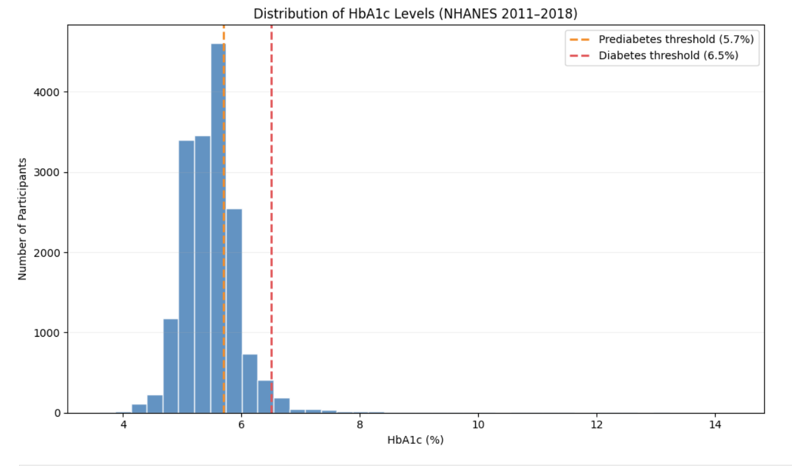

# Identifying Hidden Glycemic Risk using Machine Learning: An Analysis of U.S. Adults without diagnosed diabetes. 

- **Prepared for:** UMBC Data Science Master Degree Capstone, Dr. Chaojie (Jay) Wang 
- **Author**: Shristi Pokharel
- **GitHub Repository:** [UMBC DATA606 Capstone](https://github.com/winglessdeman/UMBC-DATA606-Capstone)
- **LinkedIn:** 
- **PowerPoint Presentation:** [Final Capstone Presentation](https://docs.google.com/presentation/d/1RcuCA3hMLdgMUhZl3_jZcrc8IVwGSDwQ/edit)
- **YouTube Presentation:** 

## 1. Project Overview

This project investigates whether non-laboratory demographic, socioeconomic,
anthropometric, behavioral, and health-history characteristics can help identify
elevated HbA1c among U.S. adults who do not report a previous diabetes diagnosis.

NHANES data from 2011–2018 are used to develop and evaluate machine-learning
models for elevated HbA1c risk. The project is intended as a research and
educational risk-screening demonstration and not as a diagnostic tool or
replacement for laboratory HbA1c testing.

# 2. Background

Diabetes and prediabetes are usually evaluated using HbA1c : a laboratory measurement that reflects average blood glucose over time. 
Some individuals might have elevated HbA1c even though they have not been officially diagnosed with diabetes.
This project uses data from the  (NHANES) National Health and Nutrition Examination Survey that is conducted by the (CDC)
National Center for Health Statistics within the Centers for Disease Control and Prevention. 
NHANES combines interviews, physical examinations and laboratory testing thus providing demographic, socioeconomic, 
anthropometric, behavioral, cardiovascular, and laboratory information for the U.S participants.

This project focuses on adults without a previously reported diabetes diagnosis. 
Laboratory-measured HbA1c will be used as the outcome source, the machine learning predictors 
will be limited primarily to variables that are available without performing HbA1c laboratory test. 
This project will investigate whether non-laboratory characteristics can be used to distinguish 
participants with normal HbA1c from the participants that have elevated HbA1c. 

HbA1c testing can identify elevated glycemic levels, but it requires a laboratory test.
In this project I explore whether the commonly available non-laboratory information such as age, BMI, waist circumference, physical activity, smoking behavior, sleep duration, income, education, hypertension, and high cholesterol can help to identify patterns associated with elevated HbA1c. If these characteristics can successfully distinguish individuals with elevated HbA1c, then the machine-learning model could demonstrate how routinely available health and lifestyle information may be used to support screening decisions and identify individuals who may benefit from further laboratory testing . Although the model cannot be used to diagnose diabetes or replace HbA1c testing it can be a risk-screening and educational tool for individuals wanting to make changes in their lifestyle and seek medical attention.   

I set 4 research questions for this project:

#### RQ1
Can non-laboratory demographic, Biometric, behavioral, cardiovascular, and socioeconomic characteristics be used to identify elevated HbA1c among adults without a previously reported diabetes diagnosis?

#### RQ2
Which non-laboratory characteristics are most important for identifying elevated HbA1c?

#### RQ3
Do behavioral and socioeconomic characteristics improve the prediction of elevated HbA1c beyond basic factors such as age and BMI?

#### RQ4
Can elevated HbA1c be identified among adults who are not obese?

The Streamlit application will be a simple glycemic-risk screening demonstration where an user would enter non-laboratory information similar to the variables used in the model, and the app would return the model's estimated likelihood/classification of elevated HbA1c.

# 3. Data

### Data Source: 
The project uses publicly available data from the CDC/NCHS National Health and Nutrition Examination Survey (NHANES). The data and documentation are available from the following links:

- NHANES website: https://www.cdc.gov/nchs/nhanes/
- NHANES data search and documentation: https://wwwn.cdc.gov/nchs/nhanes/

### Data size:
The project uses 32 SAS Transport (`.xpt`) files: eight NHANES components
from each of four survey cycles. The combined raw file size is approximately 65.20 MB.

### Data shape:
- After combining the four NHANES cycles and merging the eight components using
`SEQN`, the working merged dataset contains:

- **39,156 rows**
- **30 columns**
- **39,156 unique participants**
- **0 duplicate participant identifiers**

### Final Analysis Dataset

After study-population filtering and feature engineering, the final
analysis-ready dataset contains:

- **17,156 participants**
- **32 variables**
- **17,156 unique participant identifiers**
- **0 duplicate participant identifiers**

For the primary analysis, the study population is restricted to participants who:

- are age 20 years or older;
- have a valid laboratory HbA1c measurement; and
- reported no previous diabetes diagnosis (DIQ010 = 2).

Following exploratory data analysis (EDA), feature selection, and redundancy assessment, 13 non-laboratory predictors were selected for the final machine-learning model. The remaining variables were not all used as model inputs. Some were retained for identifying participants, constructing the target variable, feature engineering, or documenting the NHANES survey design.

### Time Period:
It includes four continuous pre-pandemic NHANES survey cycles. 

- 2011–2012
- 2013–2014
- 2015–2016
- 2017–2018

### What does each row represent?
- Each row represents the unique participant identifiers from the survey cycle.
- **SEQN**  is used as the unique participant identifier and merge key across the eight data components.

### Data Dictionary

| Column | Type | Definition | Potential Values / Units | Role |
|---|---|---|---|---|
| `age` | Numeric | Participant age | Years; 20–80 | Predictor |
| `sex` | Categorical | Participant sex | NHANES coded categories | Predictor |
| `race_ethnicity` | Categorical | Participant race/ethnicity | NHANES coded categories | Predictor |
| `education` | Categorical | Adult educational attainment | NHANES education categories | Predictor |
| `income_poverty_ratio` | Numeric | Family income-to-poverty ratio | 0–5 | Predictor |
| `bmi` | Numeric | Body Mass Index | kg/m² | Predictor |
| `waist_cm` | Numeric | Waist circumference | Centimeters (cm) | Predictor |
| `recreational_activity_minutes_week` | Numeric | Derived total vigorous and moderate recreational activity | Minutes/week | Predictor |
| `sedentary_minutes` | Numeric | Time spent sitting or reclining on a typical day | Minutes/day | Predictor |
| `smoking_status` | Categorical | Derived overall smoking status using lifetime and current smoking responses | Never, Former, Current | Predictor |
| `sleep_hours` | Numeric | Usual weekday/workday sleep duration | Hours | Predictor |
| `hypertension` | Categorical | Whether participant reports being told they have hypertension/high blood pressure | Yes / No | Predictor |
| `high_cholesterol` | Categorical | Whether participant reports being told they have high cholesterol | Yes / No | Predictor |

### NHANES Data Components and Selected Predictors

Eight NHANES data components were used to construct the analysis dataset. Six components contributed the 13 non-laboratory predictor variables, while two were used to define the prediction target and study population.

| Component | Description | Selected Predictors | Count |
|---|---|---|---:|
| `DEMO` | Demographics | `age`, `sex`, `race_ethnicity`, `education`, `income_poverty_ratio` | 5 |
| `GHB` | Glycohemoglobin | None — laboratory HbA1c used to define the target | 0 |
| `BMX` | Body Measures | `bmi`, `waist_cm` | 2 |
| `DIQ` | Diabetes Questionnaire | None — used for study eligibility | 0 |
| `PAQ` | Physical Activity | `recreational_activity_minutes_week`, `sedentary_minutes` | 2 |
| `SMQ` | Smoking | `smoking_status` | 1 |
| `SLQ` | Sleep Disorders | `sleep_hours` | 1 |
| `BPQ` | Blood Pressure & Cholesterol | `hypertension`, `high_cholesterol` | 2 |
| **Total** | **8 components** | **13 non-laboratory predictors** | **13** |

Some predictors, including recreational activity minutes per week and smoking status, were derived through feature engineering from multiple questionnaire responses.

#### Target Variable

The model predicts whether a participant has elevated HbA1c based on non-laboratory information.

| Column | Type | Definition | Potential Values / Units | Role |
|---|---|---|---|---|
| `hba1c` | Numeric | Laboratory-measured glycated hemoglobin | Percentage (%) | Target source |
| `elevated_hba1c` | Binary | Classification derived from laboratory HbA1c | 0 = HbA1c below 5.7%; 1 = HbA1c at or above 5.7% | Prediction target |

The laboratory-measured `hba1c` variable was used only to construct the classification target and was excluded from the model predictors to prevent data leakage.

# 4. Exploratory Data Analysis

Exploratory data analysis (EDA) was performed to understand the structure and quality of the analysis dataset, examine the distribution of HbA1c and candidate predictors, identify missing values and potential outliers, evaluate relationships between predictors and elevated HbA1c, and guide feature selection for machine-learning modeling.

### Data Cleaning and Preparation

NHANES data from the 2011–2012, 2013–2014, 2015–2016, and 2017–2018 survey cycles were combined for analysis.

Smoking questionnaire responses were combined into a `smoking_status` variable with three categories:

- Never
- Former
- Current

---

### HbA1c Distribution

*Figure 1. Distribution of HbA1c levels among NHANES participants (2011–2018). The dashed lines indicate the prediabetes threshold (5.7%) and diabetes threshold (6.5%).*

Before converting HbA1c into a binary target, the original laboratory HbA1c measurements were examined to understand where participants fell within the overall distribution.

| Statistic | HbA1c (%) |
|---|---:|
| Count | 17,156 |
| Minimum | 3.60 |
| 25th percentile | 5.20 |
| Mean | 5.52 |
| Median | 5.50 |
| 75th percentile | 5.70 |
| Maximum | 14.30 |
| Standard deviation | 0.60 |

HbA1c values ranged from **3.6% to 14.3%**, with a mean of **5.52%** and a median of **5.50%**.

The middle 50% of participants had HbA1c values between **5.2% and 5.7%**. The 75th percentile was 5.7%, which corresponds to the threshold used to define the elevated HbA1c target.

Although most participants were concentrated near the normal range, the maximum HbA1c value of 14.3% shows that some adults who did not report a previous diabetes diagnosis had substantially elevated laboratory measurements.

### Target Distribution

| HbA1c Group | Participants | Percent |
|---|---:|---:|
| Normal HbA1c | 11,693 | 68.16% |
| Elevated HbA1c | 5,463 | 31.84% |

Approximately **31.8% of the analysis population had elevated HbA1c**.

Because the outcome is moderately imbalanced, machine-learning performance will be evaluated using recall, precision, F1-score, ROC-AUC, and Precision-Recall AUC in addition to accuracy.

---

### Missing Data Assessment

Missingness was examined before modeling.

Some raw NHANES questionnaire variables contained high levels of missing data because of questionnaire skip patterns. For example, participants who reported no vigorous or moderate recreational activity were not asked follow-up questions about the number of activity days or minutes.

Derived variables substantially reduced this issue. Total weekly recreational activity and the combined smoking-status variable were therefore preferred over several raw questionnaire variables.

Missingness among the final candidate predictors was:

| Predictor | Missing Count | Missing Percent |
|---|---:|---:|
| Income-to-poverty ratio | 1,629 | 9.50% |
| Waist circumference | 816 | 4.76% |
| BMI | 193 | 1.12% |
| Sedentary minutes | 109 | 0.64% |
| High cholesterol | 78 | 0.45% |
| Sleep hours | 60 | 0.35% |
| Recreational activity minutes/week | 25 | 0.15% |
| Hypertension | 18 | 0.10% |
| Smoking status | 14 | 0.08% |
| Education | 13 | 0.08% |
| Age | 0 | 0.00% |
| Race/ethnicity | 0 | 0.00% |
| Sex | 0 | 0.00% |

The largest remaining missingness occurred in **income-to-poverty ratio (9.5%)** and **waist circumference (4.76%)**.

Participants were not removed solely because of missing predictor values. Missing-value imputation is handled later within the machine-learning preprocessing pipeline so that imputation parameters are learned only from training data.

---

### Continuous Variable Exploration

Continuous variables examined included:

- Age
- Income-to-poverty ratio
- BMI
- Waist circumference
- Body weight
- Vigorous recreational activity
- Moderate recreational activity
- Total recreational activity
- Sedentary time
- Sleep duration

Age, income-to-poverty ratio, sedentary time, and waist circumference showed relatively mild to moderate skewness.

BMI and body weight were more strongly right-skewed.

The physical-activity variables were strongly right-skewed and contained many zero values because many participants reported no vigorous or moderate recreational activity.

Sleep duration was approximately symmetric.

### Outlier and Plausibility Assessment

Potential outliers were examined using boxplots and the interquartile-range (IQR) rule.

Extreme values were not automatically removed because unusual observations may still represent valid measurements.

BMI, waist circumference, and body weight contained some large values, but these values were considered physiologically possible.

The IQR rule identified many physical-activity observations as outliers because these variables were highly right-skewed and contained many zero values. For this reason, IQR-based outlier detection was not considered sufficient justification for removing high physical-activity values.

A separate plausibility check compared reported sedentary time with sleep duration. Only a very small proportion of participants had combined sedentary and sleep estimates exceeding 24 hours per day. Because these measures were self-reported and the issue affected a very small portion of the population, these observations were retained.

---

### Categorical Variable Exploration

Categorical predictors included:

- Sex
- Race/ethnicity
- Education
- Smoking status
- Hypertension
- Known high cholesterol

Sex was relatively balanced between male and female participants.

Race/ethnicity was less evenly distributed, with Non-Hispanic White participants representing the largest group.

Participants with some college/AA education or a college degree represented a large portion of the education categories.

Never smokers represented the largest smoking-status group.

Most participants reported no hypertension and no known high cholesterol, although both positive categories contained several thousand participants and were sufficiently represented for analysis.

Missingness among the derived categorical predictors was minimal.

---

### Predictors and Elevated HbA1c

Both categorical and continuous predictors were compared with the `elevated_hba1c` target.

These comparisons are descriptive and unadjusted and should not be interpreted as causal relationships.

### Categorical Predictors

Elevated HbA1c prevalence was similar between:

- **Females:** 31.32%
- **Males:** 32.42%

Larger differences were observed across other categorical characteristics.

### Race/Ethnicity

| Race/Ethnicity | Elevated HbA1c |
|---|---:|
| Non-Hispanic Black | 41.93% |
| Other Hispanic | 33.46% |
| Mexican American | 33.39% |
| Non-Hispanic Asian | 32.37% |
| Non-Hispanic White | 25.64% |
| Other / Multi-Racial | 25.28% |

Non-Hispanic Black participants showed the highest observed prevalence of elevated HbA1c among the race/ethnicity categories.

### Education

| Education | Elevated HbA1c |
|---|---:|
| Less than 9th grade | 47.78% |
| 9th–11th grade | 35.93% |
| High school / GED | 34.08% |
| Some college / AA degree | 29.03% |
| College graduate or above | 26.26% |

Elevated HbA1c prevalence generally decreased as educational attainment increased.

### Smoking Status

| Smoking Status | Elevated HbA1c |
|---|---:|
| Former | 36.65% |
| Current | 31.89% |
| Never | 30.06% |

Former smokers showed somewhat higher elevated HbA1c prevalence than current or never smokers.

### Hypertension

- Hypertension: **45.97% elevated HbA1c**
- No hypertension: **25.52% elevated HbA1c**

### Known High Cholesterol

- High cholesterol: **44.42% elevated HbA1c**
- No high cholesterol: **26.50% elevated HbA1c**

Hypertension and known high cholesterol showed some of the largest categorical differences observed during EDA.

---

### Continuous Predictors and Elevated HbA1c

Continuous predictors were compared between participants with normal and elevated HbA1c.

| Variable | Normal Mean | Elevated Mean | Normal Median | Elevated Median |
|---|---:|---:|---:|---:|
| Age | 43.30 | 56.23 | 40.0 | 58.0 |
| Income-to-poverty ratio | 2.57 | 2.42 | 2.18 | 1.96 |
| BMI | 27.89 | 30.67 | 26.9 | 29.4 |
| Waist circumference (cm) | 95.49 | 103.23 | 94.0 | 102.0 |
| Weight (kg) | 78.36 | 84.49 | 75.4 | 81.05 |
| Vigorous activity (min/week) | 73.08 | 41.68 | 0 | 0 |
| Moderate activity (min/week) | 95.79 | 86.03 | 0 | 0 |
| Total recreational activity (min/week) | 168.89 | 127.77 | 60 | 0 |
| Sedentary minutes | 373.05 | 358.98 | 360 | 300 |
| Sleep hours | 7.26 | 7.19 | 7 | 7 |

Participants with elevated HbA1c were substantially older. Median age increased from **40 years in the normal group to 58 years in the elevated group**.

Anthropometric measurements also differed. Participants with elevated HbA1c had higher:

- BMI
- Waist circumference
- Body weight

Total recreational physical activity was lower in the elevated HbA1c group. Median activity was **60 minutes per week among participants with normal HbA1c compared with 0 minutes per week among participants with elevated HbA1c**.

Income-to-poverty ratio showed a smaller difference.

Sleep duration was almost identical between groups, and sedentary time showed relatively little separation.

Overall, **age, BMI, waist circumference, and recreational activity showed some of the clearest continuous-variable differences**.

---

### Correlation and Redundancy Analysis

*Figure 2. Pearson correlation heatmap showing relationships among continuous predictors examined during EDA.*

A Pearson correlation analysis was performed to identify predictors containing overlapping information.

Strong correlations were identified among anthropometric measurements:

| Variables | Correlation |
|---|---:|
| BMI and waist circumference | 0.91 |
| Waist circumference and body weight | 0.89 |
| BMI and body weight | 0.88 |

These relationships indicate substantial redundancy among measures of body size.

The physical-activity variables also showed strong correlations:

| Variables | Correlation |
|---|---:|
| Moderate activity and total recreational activity | 0.83 |
| Vigorous activity and total recreational activity | 0.73 |

This relationship is expected because total recreational activity was derived from vigorous and moderate activity.

Most other continuous predictors showed relatively weak correlations with one another.

Based on this analysis:

- `weight_kg` was excluded from the initial machine-learning predictor set because of strong redundancy with BMI and waist circumference.
- `recreational_activity_minutes_week` was retained instead of simultaneously using vigorous, moderate, and total recreational activity.
- BMI and waist circumference were initially retained because they represent related but different measures of body composition.

---

### Non-Obese Subgroup Analysis

A separate analysis was conducted among participants with **BMI below 30 kg/m²** to address whether elevated HbA1c occurs among adults who are not classified as obese.

A total of:

- **10,884 participants**
- **63.44% of the analysis population**

had BMI below 30 kg/m².

Approximately **26.5% of these non-obese adults still had elevated HbA1c**.

Within the non-obese subgroup, participants with elevated HbA1c were considerably older:

- Normal HbA1c median age: **40 years**
- Elevated HbA1c median age: **60 years**

Waist circumference also remained higher:

- Normal HbA1c median: **88.0 cm**
- Elevated HbA1c median: **93.6 cm**

Total recreational activity was lower:

- Normal HbA1c median: **60 minutes/week**
- Elevated HbA1c median: **0 minutes/week**

Categorical differences were also observed.

Among non-obese participants:

- Elevated HbA1c prevalence was **41.20% among participants with hypertension**, compared with **21.46% among participants without hypertension**.
- Elevated HbA1c prevalence was **40.24% among participants with known high cholesterol**, compared with **21.12% among those without**.
- Participants with less than a 9th-grade education had an elevated HbA1c prevalence of **40.72%**.

These findings suggest that elevated glycemic risk is not limited to adults with obesity and support evaluating additional demographic, socioeconomic, behavioral, and health-history characteristics.

---

### Summary of EDA Findings

The exploratory analysis identified several important patterns.

First, approximately **31.8% of adults without a previously reported diabetes diagnosis had elevated HbA1c**.

Participants with elevated HbA1c were generally older and had higher BMI, waist circumference, and body weight than participants with normal HbA1c.

Differences were also observed across race/ethnicity, education, hypertension, and known high-cholesterol groups. Hypertension and high cholesterol showed particularly large differences in elevated HbA1c prevalence.

Recreational physical activity was generally lower among participants with elevated HbA1c, while sleep duration and sedentary time showed relatively small unadjusted differences.

Correlation analysis identified substantial redundancy among BMI, waist circumference, and body weight and among the recreational activity variables. These findings were used to refine the candidate predictor set before modeling.

Importantly, approximately **26.5% of adults with BMI below 30 kg/m² still had elevated HbA1c**, demonstrating that elevated glycemic risk is not limited to adults with obesity.

Overall, the EDA supports the use of demographic, socioeconomic, anthropometric, behavioral, and health-history characteristics for the subsequent machine-learning analysis.

# 5. Machine Learning Modeling

The machine-learning phase of the project evaluates whether non-laboratory characteristics can be used to identify adults with elevated HbA1c.

The target variable is `elevated_hba1c`, where:

- `0` = HbA1c below 5.7%
- `1` = HbA1c at or above 5.7%

The original laboratory HbA1c measurement is not included as a predictor because it was used to define the target.

Two predictor sets were created:

1. **Baseline feature set:** age and BMI
2. **Expanded feature set:** demographic, socioeconomic, anthropometric, behavioral, and health-history characteristics

The purpose of comparing these feature sets is to determine whether additional non-laboratory information improves prediction beyond age and BMI alone.

---

The target distribution is moderately imbalanced:

- **11,693 participants (68.16%)** had normal HbA1c
- **5,463 participants (31.84%)** had elevated HbA1c

Because of this imbalance, accuracy is not used as the only performance measure. Precision, recall, F1-score, ROC-AUC, and Precision-Recall AUC are also evaluated.

### Train/Test Split

The dataset was divided into training and testing sets using an **80/20 stratified split**.

- Training set: **13,724 participants**
- Testing set: **3,432 participants**

Stratification preserved approximately the same target distribution in both datasets:

- Training set: 68.16% normal, 31.84% elevated
- Testing set: 68.15% normal, 31.85% elevated

The same training and testing participants were used for both the baseline and expanded models to allow a fair comparison.

All preprocessing steps were fitted using the training data only to reduce the risk of data leakage.

### Preprocessing

The modeling dataset contains both numerical and categorical predictors, along with a small amount of missing data.

Numerical predictors were processed using:

- Median imputation for missing values
- Standardization using `StandardScaler`

Categorical predictors were processed using:

- Most-frequent-category imputation for missing values
- One-hot encoding

Categorical NHANES variables such as sex, race/ethnicity, education, hypertension, and high cholesterol are stored using numeric codes but were treated as categorical variables during preprocessing.

All preprocessing was incorporated into scikit-learn pipelines so that transformations were learned from the training data and then applied consistently to the test data.

### Logistic Regression

Logistic Regression was selected as the first predictive model because the outcome is binary and the model provides an interpretable baseline for comparison with more complex machine-learning methods.

Two Logistic Regression models were evaluated:

1. **Baseline Logistic Regression:** age and BMI only
2. **Expanded Logistic Regression:** all 13 selected predictors

This comparison directly evaluates whether additional demographic, socioeconomic, behavioral, anthropometric, and health-history characteristics improve prediction beyond age and BMI.

### Baseline Logistic Regression